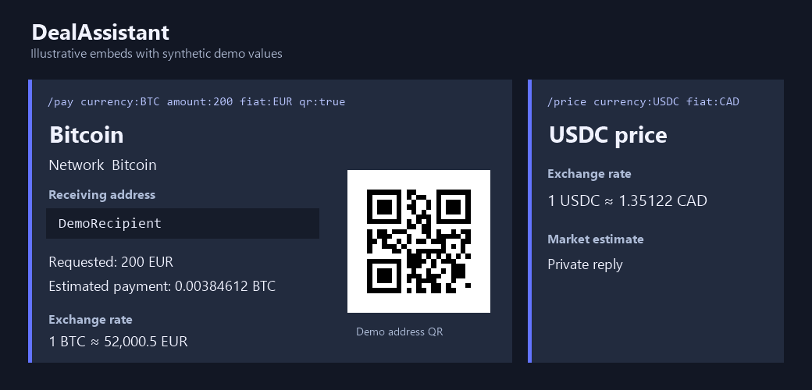

# DealAssistant

DealAssistant is a self-hosted Discord app for sharing receiving addresses,
estimating cryptocurrency payments, and showing your deal information. Install it
on your own Discord account and use slash commands in servers, DMs, and group
DMs where Discord allows them. DealAssistant never handles funds, stores private
keys, or confirms payments.

## Commands

| Example | What it does |
| --- | --- |
| `/btc amount:200` | Share the Bitcoin address and estimate a 200 USD payment |
| `/pay currency:BTC amount:200 fiat:EUR qr:true` | Estimate a 200 EUR payment and attach a PNG QR code for the address |
| `/price currency:USDC fiat:CAD` | Show the USDC market price in CAD privately |
| `/convert amount:0.5 from:ETH to:USD` | Estimate the USD value of 0.5 ETH privately |
| `/fees amount:200 percent:2.50` | Show the percentage fee and net amount privately |
| `/fees amount:200 fixed:3 fiat:CAD` | Deduct a 3 CAD fixed fee privately |



The payment shortcuts also include `/ltc`, `/eth`, `/sol`, `/usdceth`, `/usdcsol`,
and `/cashapp`. `/help` groups enabled commands by category, including your custom
commands. Enable `/fees` with `"feesEnabled": true` in `config.json`.

`/pay` only lists configured methods. Set `PAYMENT_QR_ENABLED=true` and rerun
registration to offer `qr:true`. The PNG is generated locally and contains only
the address, which remains selectable in the response.

Crypto shortcuts use USD. `/pay`, `/price`, and `/convert` support USD, EUR, GBP,
and CAD. CoinGecko rates include USDC market prices. The app caches rates for 60
seconds and shows when it retrieved them. If a rate lookup fails, payment
responses still show the address.

## Requirements

- Node.js 22.12 or newer (use the latest Node.js 24 LTS patch when possible)
- Your own Discord application, created below
- No database, no Docker, no privileged intents

## Discord application setup

1. Create a personal application in the [Discord Developer Portal](https://discord.com/developers/applications).
   Copy its **Application ID** to `DISCORD_CLIENT_ID`.
2. Copy the token from the **Bot** page to `DISCORD_TOKEN`. Under **Installation**,
   enable **User Install** and leave **Guild Install** off. The application needs
   the `applications.commands` scope. [Discord setup guide](https://docs.discord.com/developers/quick-start/getting-started)
3. In Discord, enable **Developer Mode** under **User Settings → Advanced**.
   Copy your own **User ID** to `DISCORD_OWNER_ID`. That is the only account
   that can execute commands.

### Installation restrictions

To match the private setup tested for this project, set **Installation → Install
Link → None**, then turn off **Bot → Public Bot**. Leave **Requires OAuth2 Code
Grant** off for this installation flow. Discord documents that **None** hides
the Add App entry point and **Public Bot** controls who can add an app to guilds.
Its support article also describes the requirements for switching an existing
public app to private. [Discord application settings](https://docs.discord.com/developers/resources/application#install-links) ·
[Discord developer support](https://support-dev.discord.com/hc/en-us/articles/21204493235991-How-Can-Users-Discover-and-Play-My-Activity)

From the owner account, open this direct authorization URL with your own
application ID and approve the user install. `integration_type=1` selects User
Install. [Discord OAuth2 documentation](https://docs.discord.com/developers/topics/oauth2)

```text
https://discord.com/oauth2/authorize?client_id=YOUR_APPLICATION_ID&scope=applications.commands&integration_type=1
```

A second account was denied installation of the individually owned app used
for live testing. Discord's API reported **Public Bot** off, User Install as the
only context, `applications.commands` as its scope, and no custom install URL.
The test verified that app's behavior. Check your own install route with a
second account. Independently, DealAssistant checks `DISCORD_OWNER_ID` before
processing every interaction.

Server roles with **Use External Apps** turned off receive replies from user-installed
apps privately. Visibility can vary by conversation and permissions. [Discord’s guide to apps](https://support.discord.com/hc/en-us/articles/21334461140375-Using-Apps-on-Discord)

## Configuration

All configuration lives in `.env`, plus an optional `config.json` for longer text.
Both are validated at startup; the process exits with a specific message rather
than failing later in Discord.

```bash
# copy .env.example to .env, then edit it
# on Windows: copy .env.example .env
```

### `.env`

| Variable | Required | Purpose |
| --- | --- | --- |
| `DISCORD_TOKEN` | yes | Bot token from the Developer Portal |
| `DISCORD_CLIENT_ID` | yes | Application ID |
| `DISCORD_OWNER_ID` | yes | Your Discord user ID and the only account allowed to run commands |
| `DISPLAY_NAME` | no | Name shown in embeds (default `Deal Assistant`) |
| `EMBED_COLOR` | no | Accent colour as hex (default `#5865F2`) |
| `EMBED_FOOTER` | no | Footer text added to every embed |
| `BTC_ADDRESS`, `LTC_ADDRESS`, `ETH_ADDRESS`, `SOL_ADDRESS`, `USDC_ETH_ADDRESS`, `USDC_SOL_ADDRESS` | no | Public receiving addresses; a payment command only appears when its address is set |
| `CASHAPP_TAG` | no | Cash App tag; enables `/cashapp` |
| `PAYMENT_QR_ENABLED` | no | Set to `true` to offer `qr:true` on supported methods |
| `TELEGRAM_URL`, `WEBSITE_URL`, `EMAIL_ADDRESS`, `MARKETPLACE_PROFILE_URL`, `VOUCH_THREAD_URL` | no | Contact links; unset links are omitted from `/info` |
| `ENABLED_COMMANDS` | no | Comma-separated allowlist, for example `btc,info,help`. Blank enables everything that is configured |

Only public receiving addresses are needed. Never put a seed phrase or private key
in this file.

### Payment addresses

Addresses are validated against the network for their command when the app starts.
An invalid value stops startup with a message naming the variable; the value itself
is never echoed and is never corrected or rewritten.

| Command | Network | Accepted format |
| --- | --- | --- |
| `btc` | Bitcoin | Base58Check (`1…`, `3…`) or bech32/bech32m (`bc1…`) |
| `ltc` | Litecoin | Base58Check (`L…`, `M…`, `3…`) or bech32/bech32m (`ltc1…`) |
| `eth`, `usdceth` | Ethereum | `0x` plus 40 hex characters; mixed case must satisfy EIP-55 |
| `sol`, `usdcsol` | Solana | Base58 that decodes to 32 bytes |

Bech32 addresses are checksum-verified, and version 0 witness programs must use
bech32 while version 1 and above must use bech32m. A Litecoin address in a Bitcoin
variable, or a broken EIP-55 checksum, is rejected rather than accepted.

Validation only proves the string is well formed for that network. It cannot prove
you own the address, and it cannot prove that a particular wallet or exchange
supports receiving a specific token on that network. USDC on Ethereum and USDC on
Solana are different networks with different addresses.

### `config.json`

Copy the optional example to customize text, payment methods, or commands.

```bash
cp config.example.json config.json
```

```json
{
  "infoMessage": "Hi, I'm {displayName}.",
  "middlemanPolicy": ["First line.", "Second line."],
  "vouchTemplate": "> **{amount} deal, quick and easy.**",
  "vouchTemplateNoAmount": "> Thanks for the deal."
}
```

`{displayName}` and `{amount}` are replaced at runtime. Omitted keys fall back to
the defaults shown in `config.example.json`. `config.json` is git-ignored because
it holds personal text. Text is measured against Discord's embed limits after
substitution, so an oversized message is reported at startup.

#### Add a payment method

The `paymentMethods` array adds choices to `/pay`. Fill in your own public
recipient details. This example uses a fictional service and identifier.

```json
{
  "paymentMethods": [
    {
      "id": "EXAMPLE-PAY",
      "displayName": "Example payment service",
      "symbol": "USD",
      "network": "Example service",
      "recipient": "ExampleRecipient",
      "instructions": "Include the invoice reference."
    }
  ]
}
```

Methods like this show the identifier exactly as configured and ask the reader
to verify it manually. For a blockchain address, set `addressFormat` to
`btc`, `ltc`, `eth`, or `sol` to check its format. Add `qr: true` to allow
address QR codes when `PAYMENT_QR_ENABLED` is also true.

Conversion requires a matching asset, network, and `addressFormat`. For example,
an ETH entry uses `symbol: "ETH"`, `network: "Ethereum"`, `addressFormat: "eth"`,
and `priceId: "ethereum"`. The other pairs use the network names in the address
table and CoinGecko IDs `bitcoin`, `litecoin`, `solana`, or `usd-coin`. For USDC,
use `Ethereum (ERC-20)` with `eth` or `Solana (SPL)` with `sol`. Optional
`decimals` can reduce the precision shown in estimates. Discord allows 25
`/pay` choices, including configured built-in methods.

#### Add a custom command

Add entries to `customCommands` for commands such as `/terms`, `/links`,
or `/rules`. Each needs a unique lowercase command name, a Discord description,
and embed content.

```json
{
  "customCommands": [
    {
      "name": "rules",
      "description": "Share the trade rules.",
      "title": "{displayName} trade rules",
      "body": "**Deal reference** {reference}",
      "fields": [{ "name": "Before payment", "value": "Confirm the network." }],
      "links": [{ "label": "Full rules", "url": "https://example.invalid/rules" }],
      "options": [{ "name": "reference", "description": "Deal reference", "maxLength": 24 }]
    }
  ]
}
```

Embed content can include an optional `color` and `footer`. Templates in titles,
bodies, fields, and footers accept `{displayName}` and the names of up to five
optional plain-text parameters. An omitted parameter displays an em dash. Links
use full HTTP or HTTPS URLs. If you use `ENABLED_COMMANDS`, include the custom
command names you want to register. Discord allows 100 enabled slash commands per
application.

## Installation and startup

```bash
npm ci
# copy .env.example to .env and fill it in
npm run register          # once, and again whenever commands change
npm start
```

`register` and `start` are different steps:

- `register` uploads the slash command definitions to Discord. Run it once after
  configuring, and again after changing command names, options, or the list of
  configured payment methods.
- `start` connects the application to Discord and answers commands. It must keep
  running.

Global command updates can take up to an hour to appear in Discord. If a command is
missing, re-run `register`, wait, and restart your Discord client.

After updating DealAssistant, run `npm ci` to install the locked dependencies
and `npm run register` to update the commands before restarting.

### Windows

After `npm install` and a filled-in `.env`, double-click `start-dealassistant.bat`.
It checks the Node.js version, installs dependencies if they are missing, and
starts the app.

### Linux and VPS

Run the service as a dedicated unprivileged account rather than root:

```bash
sudo useradd --system --home /opt/DealAssistant --shell /usr/sbin/nologin dealassistant
sudo mkdir -p /opt/DealAssistant
sudo chown -R dealassistant:dealassistant /opt/DealAssistant

# place the project in /opt/DealAssistant, then
cd /opt/DealAssistant
sudo -u dealassistant npm ci --omit=dev
sudo -u dealassistant npm run register

# the .env file holds a bot token, so restrict it to the service account
sudo chown dealassistant:dealassistant /opt/DealAssistant/.env
sudo chmod 600 /opt/DealAssistant/.env
```

```ini
[Unit]
Description=DealAssistant
After=network-online.target
Wants=network-online.target

[Service]
Type=simple
User=dealassistant
Group=dealassistant
WorkingDirectory=/opt/DealAssistant
ExecStart=/usr/bin/node src/index.js
EnvironmentFile=/opt/DealAssistant/.env
Restart=on-failure
RestartSec=5

# the process needs no write access and no extra privileges
NoNewPrivileges=true
PrivateTmp=true
ProtectSystem=strict
ProtectHome=true
ProtectKernelTunables=true
ProtectControlGroups=true
RestrictAddressFamilies=AF_INET AF_INET6
RestrictNamespaces=true
LockPersonality=true
UMask=0077

[Install]
WantedBy=multi-user.target
```

`pm2 start src/index.js --name dealassistant` also works if you prefer a process
manager.

## Security

- The bot token is a credential. `.env` is git-ignored; never commit or share it.
- Only `DISCORD_OWNER_ID` may run commands. The check is centralised in
  `src/auth.js` and applies to every interaction type.
- The app requests no privileged intents and no bot permissions. It only needs the
  `applications.commands` scope.
- Nothing is stored: no database, no message content, no logging of addresses or
  users.
- Logs are filtered for tokens, webhook URLs and bearer headers before anything is
  written.
- Do not paste seed phrases or private keys into `.env`, `config.json`, or chat.

## Troubleshooting

**Commands do not appear.** Run `npm run register` again. Global commands can take
up to an hour. Confirm you installed the app to your own account ("Add to my
apps"), and that `DISCORD_CLIENT_ID` belongs to the same application as the token.
Restart the Discord client.

**Startup stops with a configuration error.** The message names the variable. An
invalid address, a malformed URL, an oversized embed text, or a missing owner ID all
stop startup on purpose. Fix the value and start again.

**`Invalid token` on startup.** The token was copied incorrectly or was reset.
Generate a new one on the Bot page and update `DISCORD_TOKEN`.

**"This application is private" reply.** The account you are using is not
`DISCORD_OWNER_ID`. Copy your own user ID again — it is not the application ID.

**A command is missing.** Its address is not configured, or `ENABLED_COMMANDS`
excludes it. The startup log lists disabled commands with the reason.

**A command replies that it is unavailable.** The registered command no longer
exists in this configuration. Re-run `npm run register`.

**Replies only appear to you in a server.** Check whether your role can use
external apps publicly in that channel.

**The rate shows as unavailable.** CoinGecko was unreachable or rate limited. The
address is still returned. Requests are not retried to avoid worsening a rate
limit.

**`config.json could not be parsed`.** The file is not valid JSON — check trailing
commas and unescaped quotes.

## Tests

```bash
npm test
```

The suite uses mocked Discord and CoinGecko calls. It covers address validation,
decoded PNG payloads, rate handling, embed limits, owner authorization, log
redaction, and custom configuration. GitHub Actions runs the suite on Node.js
22 and 24 and audits production dependencies.

### Live Discord smoke test

Try a command as the owner in a test server, a DM with the app, and a group DM
with test participants. For a payment with `qr:true`, download and scan the
image and compare it with the selectable address. Try a custom command with an
optional parameter and select a custom method from `/pay`. These checks require
no transfers. With an alternate account, verify the private installation
behavior separately from the app's automated authorization tests.

## License

MIT. See [LICENSE](LICENSE). Address encoding uses [@scure/base](https://github.com/paulmillr/scure-base)
and [js-sha3](https://github.com/emn178/js-sha3). Address QR images use
[qr](https://github.com/paulmillr/qr), available under MIT or Apache-2.0. Node.js writes
the PNG using its built-in zlib module.
